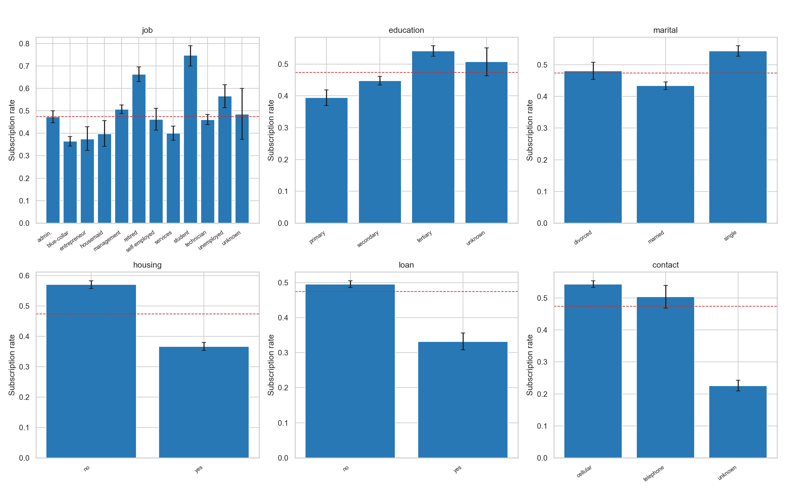
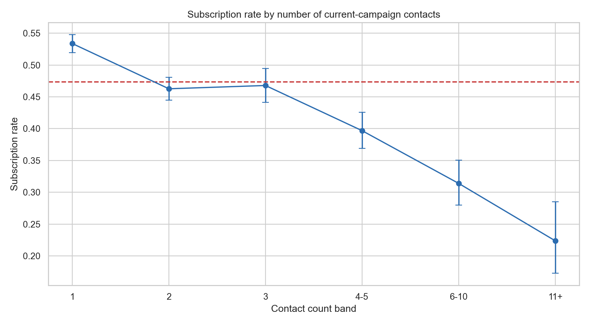
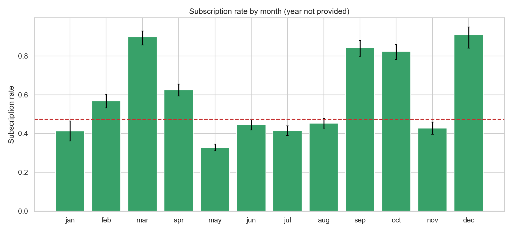
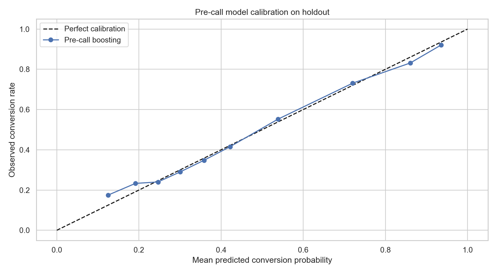
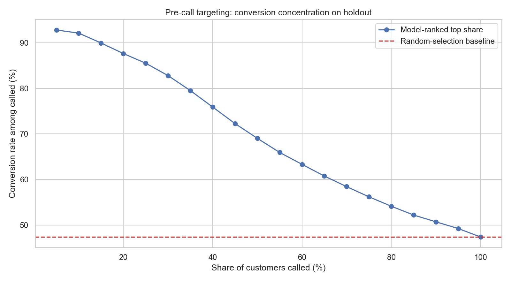

# The Last Call Is Not the Best Call: A Bank Campaign Efficiency Audit

A reproducible analysis of the supplied bank campaign dataset, focused on a practical question: **how can a bank increase term-deposit conversions without simply calling customers more often?** The project separates pre-call targeting from post-call explanation, measures campaign conversion patterns, and tests a holdout-based prioritization model.

> Educational analysis only. This dataset does not support causal impact or return-on-investment claims.

## Project summary

This project goes beyond a routine response-rate chart or a classifier leaderboard. It investigates contact pressure, conversion differences across customer and campaign segments, statistical effect sizes, and whether pre-call information can concentrate likely subscribers among a limited call budget. It deliberately excludes call duration from pre-call targeting because duration is known only after a call and would create leakage.

**Primary decision question:** If the bank can call only a fraction of eligible customers, can a model rank likely subscribers better than random selection—and what evidence would be needed before changing real campaign policy?

## Dataset profile

The attached `bank.csv` was inspected directly:

- **11,162 rows and 17 columns**
- **No missing cells and no exact duplicate rows**
- Target `deposit`: 5,289 yes and 5,873 no; observed subscription rate approximately **47.4%**
- Contains customer descriptors, financial attributes, current-campaign contact details, prior campaign history, and outcome
- `pdays = -1` means no prior contact in this dataset; the notebook encodes it as `previously_contacted` and makes those `pdays` values missing
- Category values such as `unknown` are retained rather than silently dropped

### Field reference

| Fields | Description / analysis role |
|---|---|
| `age`, `job`, `marital`, `education` | Customer descriptors used for segment summaries and pre-call model features |
| `default`, `balance`, `housing`, `loan` | Existing financial indicators |
| `contact`, `day`, `month`, `campaign` | Current-campaign contact context |
| `pdays`, `previous`, `poutcome` | Prior campaign contact history; `pdays=-1` denotes no previous contact |
| `duration` | Call duration; only used in the post-call diagnostic, never the pre-call model |
| `deposit` | Target outcome: subscribed to a term deposit (`yes`/`no`) |

The source URL, collector, campaign year, collection method, and license should be recorded from the original dataset page before publishing. This README does not assume those details.

## Repository layout

```text
bank-campaign-efficiency-audit/
├── README.md
├── bank_campaign_efficiency_audit.ipynb
├── requirements.txt
├── .gitignore
├── bank.csv                    # local only unless the source license allows redistribution
└── images_bank/                # generated when the notebook runs
    ├── 01_conversion_segments.png
    ├── 02_contact_saturation.png
    ├── 03_monthly_conversion.png
    ├── 04_pre_call_calibration.png
    └── 05_targeting_lift.png
```

The notebook expects `bank.csv` in the same folder. If you put it in a `data/` folder, update `DATA_PATH` near the top of the notebook to `Path('data/bank.csv')`. Image files are generated outputs and do not exist until the notebook runs successfully.

## Run locally

1. Install Python 3.10+ and Jupyter Notebook or JupyterLab.
2. Put `bank.csv` beside the notebook, or update `DATA_PATH` as described above.
3. Install project dependencies: `python -m pip install -r requirements.txt`.
4. Open `bank_campaign_efficiency_audit.ipynb`.
5. Choose **Restart Kernel and Run All Cells**.
6. Confirm all cells complete, then inspect the printed tables and generated charts under `images_bank/`.
7. Replace result prompts in the notebook or this README only with findings from your actual run.

## Analysis design

### 1. Data checks and preparation

The notebook validates expected columns, target labels, duplicate rows, missing values, and special values. It retains `unknown` categories. It converts `pdays=-1` into a no-prior-contact indicator rather than treating -1 as a literal number of elapsed days. It engineers campaign-count, age, and balance bands for readable segment comparisons.

### 2. Segment conversion and uncertainty

It calculates subscription rates across job, education, marital status, housing, existing loan, contact method, month, and prior campaign outcome. 95% Wilson intervals communicate uncertainty, especially for smaller segments. A baseline line gives context; the output is descriptive, not causal.

### 3. Contact-pressure analysis

Current-campaign contacts are grouped and compared with conversion. This can identify a pattern consistent with diminishing returns, but it cannot establish that an extra call caused a lower response: harder-to-convert clients may simply receive more attempts.

### 4. Statistical association

Chi-square tests are paired with Cramer's V effect sizes. With over 11,000 records, small differences can produce low p-values; effect size and practical meaning matter too.

### 5. Leakage-aware predictive comparison

The stratified holdout compares a logistic regression baseline and gradient boosting. The **pre-call** feature set uses fields available before a call and excludes `duration`. A separate **post-call diagnostic** includes duration to demonstrate how outcome information can make a model look stronger while making it unusable for pre-call selection. Metrics include ROC-AUC, average precision, Brier score, and a calibration plot.

### 6. Prioritization simulation

The notebook ranks held-out records with the pre-call model and compares conversion among the top-ranked share with the overall baseline. This is predictive concentration, not incremental campaign lift. It does not claim ROI because no call costs, deposit amounts, or margins are provided.

## Visualizations

Run the notebook first; these relative image links work on GitHub once the PNGs have been generated and committed.

### Conversion by customer and contact segments



### Contact saturation pattern



### Month-level conversion



### Pre-call model calibration



### Targeting concentration



## Results to report after execution

Do not invent these values. Run all cells and fill them from printed outputs:

- Overall subscription rate: **[verified output]**
- Strongest useful segment pattern and its sample size / interval: **[verified output]**
- Pre-call model ROC-AUC, average precision and Brier score: **[verified output]**
- Top-10% ranked group conversion and lift versus baseline: **[verified output]**
- Post-call diagnostic versus pre-call performance, with explicit leakage caveat: **[verified output]**
- Recommended next experiment: a randomized, cost-tracked pilot across score bands

## What the data cannot tell us

- **No causal lift:** there is no randomized treatment/control assignment. Segment differences and model rankings do not show that a contact caused a subscription.
- **No ROI:** call cost, deposit amount, interest margin, account duration, and customer lifetime value are absent.
- **No campaign chronology:** month exists but year does not, preventing year-over-year trend or temporal holdout validation.
- **No unique customer identifier:** repeated customers across rows cannot be identified or separated between train/test; record-level splitting may therefore overstate generalization if repeat clients exist.
- **Duration leakage:** call duration is post-contact information and is not valid for deciding who to call beforehand.
- **Potential bias:** demographic and financial fields can proxy for protected characteristics. This model is a research demonstration, not a deployable decision system; any operational use requires fairness, privacy, consent, and legal review.
- **Observational contact counts:** contact frequency is not randomly assigned, so a pattern does not prove extra calls help or hurt.

## Suggested next step for a real bank

Run a randomized pilot within eligible risk/propensity bands. Log contact attempts, cost, consent, complaints, opt-outs, deposit amounts, and realized margin; reserve a future campaign wave for evaluation. Compare incremental conversions and net value against a control group, not just AUC or historical conversion.

